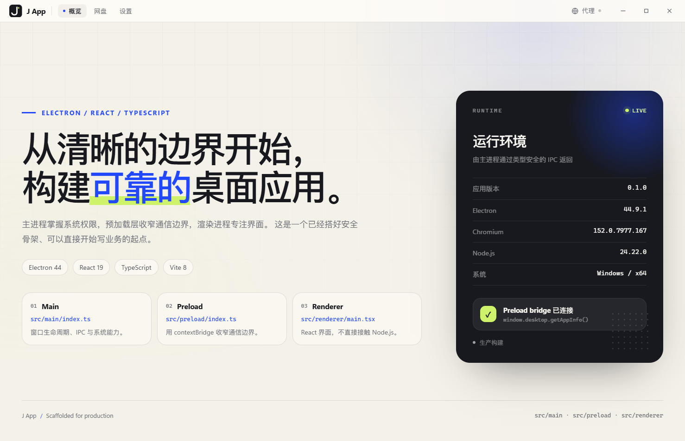
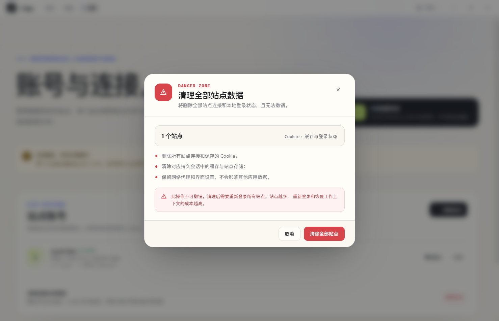
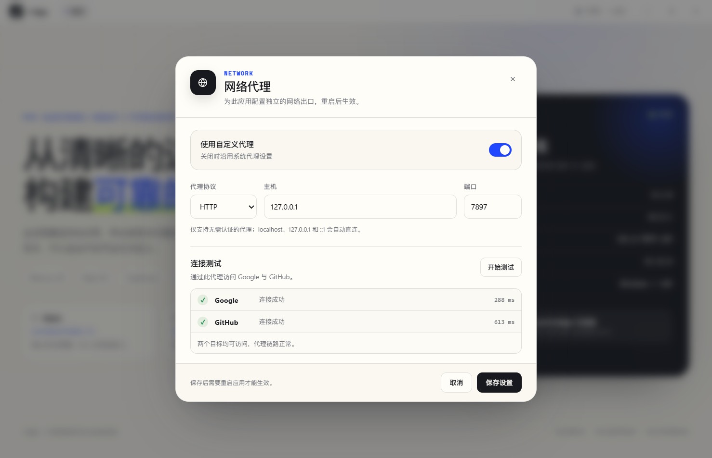
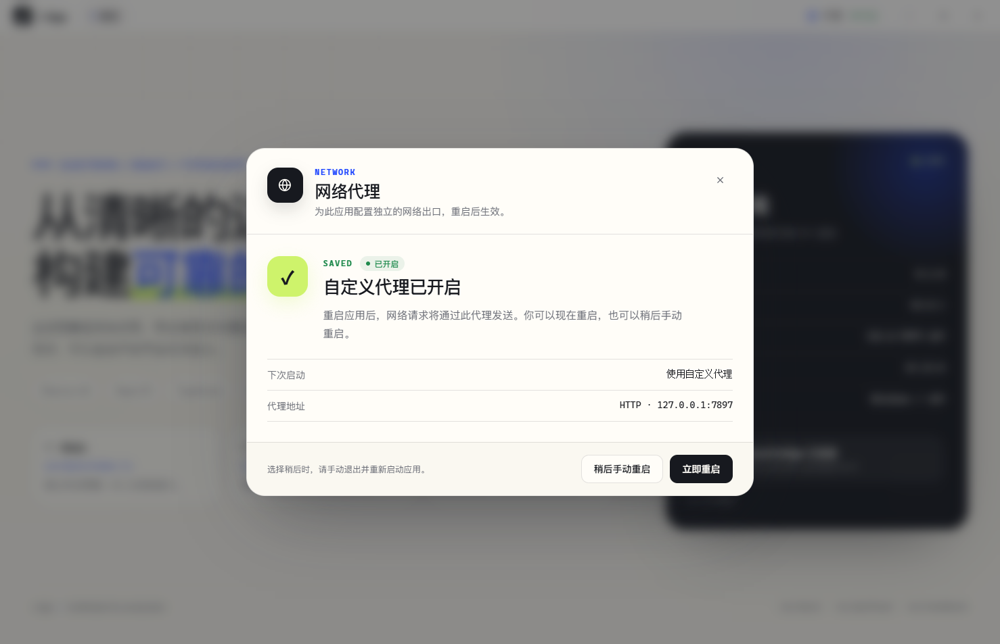
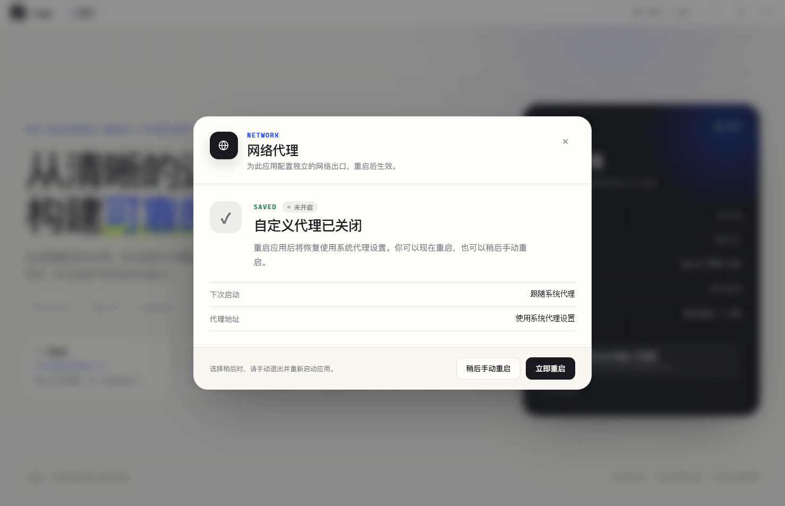

# J App

一个面向实际开发起步的 Electron 桌面应用工程：**Electron Forge + Vite + React 19 + TypeScript**。

项目已经处理好主进程、预加载脚本、渲染进程的边界，并把 IPC 契约集中到共享类型中。当前包含中心化配置、三档主题外观、网络代理、页面导航、按站点隔离的 Cookie 会话管理、115 网盘浏览与文件管理、本地视频库和通用播放器，以及系统托盘、Windows 自动更新和 GitHub Releases 发布链路。



## 技术栈

- **Electron 44** — 桌面运行时
- **Electron Forge 8** — 开发、打包与安装包制作
- **Vite 8** — 主进程、预加载与渲染层构建，渲染层支持 HMR
- **React 19 + TypeScript 6** — 严格类型的界面开发
- **Vitest + Testing Library** — 渲染层单元测试
- **Zod** — 集中配置的结构校验
- **Oxlint + Oxfmt** — 静态检查与代码格式化
- **pnpm** — 依赖管理

## 快速开始

环境要求：Node.js `>= 22.12`，pnpm 11（仓库声明了 `packageManager`，Corepack 可直接识别）。

```bash
pnpm install
pnpm dev
```

`pnpm dev` 会启动 Forge 开发环境。渲染层支持 Vite HMR；主进程与预加载脚本变更后会自动重启应用。

## 常用命令

| 命令                  | 说明                                     |
| --------------------- | ---------------------------------------- |
| `pnpm dev`            | 启动开发环境（`pnpm start` 同义）        |
| `pnpm typecheck`      | 运行 TypeScript 类型检查                 |
| `pnpm lint`           | 使用 Oxlint 检查源码                     |
| `pnpm lint:fix`       | 自动修复可修复的 lint 问题               |
| `pnpm format`         | 使用 Oxfmt 格式化代码                    |
| `pnpm format:check`   | 检查格式是否符合规范                     |
| `pnpm icons:generate` | 从 `public/favicon.svg` 重新生成应用图标 |
| `pnpm test`           | 运行一次单元测试                         |
| `pnpm test:watch`     | 监听模式运行测试                         |
| `pnpm check`          | 依次执行类型检查、lint、格式检查与测试   |
| `pnpm precommit`      | 手动执行提交流程（自动修复 + 完整校验）  |
| `pnpm package`        | 打包当前平台的未压缩应用                 |
| `pnpm make`           | 生成当前平台的安装包                     |

## Git 提交钩子

项目通过 Husky 在 `git commit` 前执行 [.husky/pre-commit](.husky/pre-commit)，流程分两步：

1. `lint-staged` 只处理本次暂存的文件：`oxlint --fix` 自动修复可修复的 lint 问题，`oxfmt --write` 统一格式，并把修复结果重新加入暂存区；
2. 执行完整的 `pnpm check`，再次验证类型、lint、格式和测试。

任何一步失败都会中止提交。`pnpm install` 会通过 `prepare` 脚本自动安装钩子；也可以随时手动运行：

```bash
pnpm precommit
```

如果遇到紧急情况需要绕过检查，可以使用 `git commit --no-verify`，但不要把它当作常规流程。

## 目录结构

```text
j-app/
├─ docs/
│  ├─ preview.png               # 主界面截图
│  ├─ preview-dark.png          # 深色概览截图
│  ├─ settings-page.png         # 浅色设置页
│  ├─ settings-dark.png         # 深色设置页
│  ├─ cookie-dialog.png         # 添加站点登录弹窗
│  ├─ clear-all-dialog.png      # 清理全部站点确认弹窗
│  ├─ cookie-sessions.md        # 站点 Cookie 会话功能文档
│  ├─ drive-115.md              # 115 网盘浏览与文件操作文档
│  ├─ local-video.md            # 本地视频库、封面匹配与协议文档
│  ├─ themes.md                 # 主题与外观功能文档
│  ├─ proxy-dialog.png          # 网络代理弹窗
│  ├─ proxy-saved.png           # 开启代理后的重启提示
│  └─ proxy-saved-off.png       # 关闭代理后的重启提示
├─ public/
│  └─ favicon.svg               # 网页 favicon，也是应用图标的唯一源文件
├─ resources/
│  ├─ icon.png                  # 512px 通用图标，开发窗口与 Linux 打包使用
│  ├─ icon.ico                  # Windows 应用、任务栏与安装器图标
│  └─ icon.icns                 # macOS 应用图标
├─ scripts/
│  ├─ generate-icons.mjs        # 由 favicon.svg 生成各平台图标
│  └─ serve-updates.mjs         # CI 中为 Squirrel 差分构建提供历史更新镜像
├─ .github/
│  └─ workflows/release.yml     # Tag 触发的 Windows Release 构建与发布
├─ .husky/
│  └─ pre-commit                # Git 提交前自动修复与校验
├─ .lintstagedrc.json           # 暂存文件的 Oxlint/Oxfmt 自动修复规则
├─ src/
│  ├─ main/                     # 主进程：拥有系统权限
│  │  ├─ appearance/
│  │  │  └─ theme.ts            # nativeTheme、主题持久化与启动应用
│  │  ├─ connections/
│  │  │  ├─ partition-cleanup.ts # 启动时清理无主站点分区
│  │  │  ├─ partition.ts         # 分区命名与无主分区识别
│  │  │  ├─ session-manager.ts   # 登录窗口、持久 Session 与 Cookie 生命周期
│  │  │  ├─ login-validation.ts  # 115 登录完成校验
│  │  │  ├─ persist-cookies.ts   # 将 115 会话 Cookie 提升为持久 Cookie
│  │  │  └─ site-profile.ts      # 站点会话的桌面 Chrome UA 兼容配置
│  │  ├─ drive/
│  │  │  ├─ 115.ts              # 目录列表、搜索、文件操作与登录检测
│  │  │  ├─ 115-http.ts         # 115 HTTP 请求、Cookie 与错误封装
│  │  │  ├─ accounts.ts         # 识别可用的 115 站点连接
│  │  │  ├─ actions.ts          # 新建、重命名、移动、删除等文件操作
│  │  │  ├─ detection.ts        # 115 登录地址识别
│  │  │  ├─ download.ts         # 文件/视频下载、取消与保存
│  │  │  ├─ ipc.ts              # 网盘 IPC 结果封装
│  │  │  ├─ mapper.ts           # 115 文件响应归一化
│  │  │  ├─ offline.ts          # 离线任务提交与状态查询
│  │  │  ├─ offline-mapper.ts   # 离线任务响应归一化
│  │  │  ├─ playback.ts         # 视频播放地址与一次性 Cookie
│  │  │  ├─ subtitles.ts        # 本地字幕目录读取与解码
│  │  │  ├─ subtitle-matcher.ts # 视频与字幕文件名匹配
│  │  │  └─ upload.ts           # 上传初始化、OSS 流式上传与进度
│  │  ├─ local-video/
│  │  │  ├─ ipc.ts               # 文件夹选择、扫描与进度 IPC
│  │  │  ├─ protocol.ts          # japp-local 视频/封面协议与 Range
│  │  │  ├─ registry.ts          # 视频/封面 ID 到路径的注册表
│  │  │  ├─ scanner.ts           # 递归扫描、视频识别与封面匹配
│  │  │  └─ subtitles.ts         # 115 同款模糊匹配、设置字幕目录与同目录读取
│  │  ├─ network/
│  │  │  └─ proxy.ts            # 启动时应用代理、代理连接测试
│  │  ├─ settings/
│  │  │  ├─ defaults.ts         # 默认配置
│  │  │  ├─ schema.ts           # Zod 配置校验与版本迁移
│  │  │  ├─ schema.test.ts      # 配置校验测试
│  │  │  └─ store.ts            # 单文件配置仓库、原子写入与坏文件恢复
│  │  ├─ app-icon.ts          # 窗口、托盘与通知共用的应用图标路径
│  │  ├─ desktop-behavior.ts  # 托盘关闭、开机自启与启动隐藏策略
│  │  ├─ dev-user-data.ts     # 开发环境独立 userData 与一次性迁移
│  │  ├─ index.ts             # 应用生命周期、单实例、启动流程
│  │  ├─ ipc.ts               # ipcMain 处理器
│  │  ├─ security.ts          # CSP 与 webview 防护
│  │  ├─ tray.ts              # 托盘图标、菜单与快捷入口
│  │  ├─ updates/
│  │  │  ├─ feed.ts           # update.electronjs.org 地址与平台支持判断
│  │  │  └─ manager.ts        # autoUpdater 状态、检查、下载与安装
│  │  ├─ window-state.ts      # 窗口尺寸校验、多显示器回退
│  │  └─ window.ts            # BrowserWindow、导航、外链与窗口状态持久化
│  ├─ preload/                  # 预加载：受控 API 边界
│  │  └─ index.ts               # contextBridge 暴露 window.desktop
│  ├─ renderer/                 # 渲染进程：只负责 UI
│  │  ├─ features/
│  │  │  ├─ drive/              # 115 网盘功能域
│  │  │  │  ├─ components/      # 网盘专属弹窗、上传/下载/离线面板
│  │  │  │  │  ├─ DriveActionDialog.tsx
│  │  │  │  │  ├─ DriveMoveDialog.tsx
│  │  │  │  │  ├─ DriveFolderPickerDialog.tsx
│  │  │  │  │  ├─ DriveUploadPanel.tsx
│  │  │  │  │  ├─ DriveDownloadPanel.tsx
│  │  │  │  │  ├─ DriveOfflineDialog.tsx
│  │  │  │  │  └─ *.module.css  # 对应弹窗与面板样式
│  │  │  │  ├─ lib/
│  │  │  │  │  └─ drive-playlist.ts # 当前目录视频过滤、排序与短标题
│  │  │  │  └─ playback/
│  │  │  │     ├─ DrivePlaybackProvider.tsx # 115 播放数据接入
│  │  │  │     └─ useDrivePlayback.ts # 会话、竞态、进度与自动连播
│  │  │  └─ local-video/        # 本地视频库功能域
│  │  │     ├─ LocalVideoPage.tsx # 多文件夹、筛选、分组与搜索排序
│  │  │     ├─ LocalVideoPage.module.css
│  │  │     ├─ LocalVideoProvider.tsx # 多库扫描、字幕与本地播放器请求
│  │  │     ├─ LocalVideoPage.test.tsx
│  │  │     └─ local-video-preferences.ts # 视图、分组与本地进度
│  │  ├─ components/
│  │  │  ├─ video-player/       # 通用 HLS 播放器、工具栏、播放列表抽屉
│  │  │  │  ├─ VideoPlayerDialog.tsx
│  │  │  │  ├─ VideoPlayerToolbar.tsx
│  │  │  │  ├─ VideoPlayerDrawer.tsx
│  │  │  │  ├─ useVideoMediaState.ts
│  │  │  │  ├─ PlayerIcons.tsx
│  │  │  │  ├─ types.ts
│  │  │  │  ├─ *.module.css     # 播放器、工具栏、抽屉与自适应样式
│  │  │  │  └─ index.ts
│  │  │  ├─ AddSiteDialog.tsx    # 添加站点或仅保存预设
│  │  │  ├─ AppMark.tsx          # 与桌面图标一致的内联 SVG 标志
│  │  │  ├─ ClearAllSitesDialog.tsx # 清理全部站点确认弹窗
│  │  │  ├─ DownloadSettings.tsx # 下载目录与字幕目录设置
│  │  │  ├─ GlobeIcon.tsx        # 网络代理与站点图标
│  │  │  ├─ ProxyDialog.tsx      # 代理配置、测试与重启提示弹窗
│  │  │  ├─ SiteDialogs.module.css # 站点弹窗共享样式
│  │  │  ├─ ThemeIcon.tsx        # 主题菜单图标
│  │  │  ├─ ThemeSettings.tsx    # 三档主题选择与预览
│  │  │  ├─ TitleBar.tsx         # 自定义标题栏、导航与窗口控制
│  │  │  ├─ UpdateSettings.tsx   # 当前版本、检查更新与重启安装
│  │  │  └─ *.module.css         # 组件样式
│  │  ├─ playback/              # 与业务无关的全局播放宿主
│  │  │  ├─ GlobalVideoPlayerProvider.tsx
│  │  │  ├─ GlobalVideoPlayerProvider.module.css
│  │  │  └─ GlobalVideoPlayerProvider.test.tsx
│  │  ├─ hooks/
│  │  │  ├─ useAppearance.ts    # 主题加载、保存与系统主题同步
│  │  │  └─ useAppInfo.ts       # IPC 数据加载与重试
│  │  ├─ lib/
│  │  │  ├─ errors.ts           # IPC 错误消息整理
│  │  │  ├─ file-kind.ts        # 扩展名到文件类型映射
│  │  │  ├─ playback-progress.ts # 播放进度读写与格式化
│  │  │  ├─ player-preferences.ts # 音量/静音记忆与会话级倍速
│  │  │  ├─ subtitles.ts        # SRT/VTT/ASS/SSA 解析
│  │  │  └─ theme.ts            # 主题偏好解析与标题栏状态
│  │  ├─ pages/
│  │  │  ├─ OverviewPage.tsx    # 概览页
│  │  │  ├─ DrivePage.tsx       # 115 网盘页面交互与状态
│  │  │  ├─ SettingsPage.tsx    # 外观、账号、下载与数据清理
│  │  │  └─ *.module.css        # 页面样式
│  │  ├─ styles/
│  │  │  ├─ global.css          # 全局样式入口
│  │  │  ├─ tokens.css          # 设计 Token、亮/暗变量
│  │  │  ├─ base.css            # reset、窗口外壳、页脚与全局暗色规则
│  │  │  ├─ page.module.css     # 页面共享布局与排版
│  │  │  ├─ ui.module.css       # 共享按钮、加载指示器与提示框
│  │  │  └─ reduced-motion.css  # 减少动画偏好
│  │  ├─ App.test.tsx           # 渲染层集成测试
│  │  ├─ App.tsx                # 页面切换、标题栏与全局 Provider
│  │  ├─ navigation.ts          # 主导航配置
│  │  └─ main.tsx               # React 入口
│  ├─ shared/                   # 三端共享的纯类型与契约
│  │  ├─ appearance.ts          # 主题偏好与解析状态
│  │  ├─ connections.ts         # 站点连接与 Cookie 摘要类型
│  │  ├─ drive.ts               # 网盘账号、目录、文件操作与上传契约
│  │  ├─ ipc.ts                 # 通道名、AppInfo、DesktopApi
│  │  ├─ local-video.ts         # 本地视频库、封面与扫描 API 契约
│  │  ├─ settings.ts            # 应用设置与代理数据类型
│  │  └─ window.d.ts            # window.desktop 的全局类型
│  └─ types/
│     └─ electron-forge.d.ts    # Forge Vite 注入变量的类型
├─ index.html                   # 渲染层 HTML 入口
├─ forge.config.mts             # Forge、Maker 与 Fuses 配置
├─ vite.main.config.mts
├─ vite.preload.config.mts
├─ vite.renderer.config.mts
├─ vitest.config.mts
├─ tsconfig.json
├─ .oxlintrc.json
└─ .oxfmtrc.json
```

`@shared/*` 别名在 TypeScript、三个 Vite 配置和 Vitest 中保持一致，用来引用跨进程契约。进程内部代码使用相对路径，跨边界代码使用别名，避免目录移动时产生大量路径修改。

渲染层按功能域组织：115 专属组件、目录视频排序和播放适配集中在 `src/renderer/features/drive/`；本地视频库、多文件夹、网格/列表和本地播放请求集中在 `src/renderer/features/local-video/`；通用播放器 `components/video-player/` 和全局宿主 `playback/GlobalVideoPlayerProvider` 不依赖具体业务契约。页面仍保留在 `pages/` 或 feature 内，作为路由层组合 feature。

## 样式组织

`src/renderer/styles/global.css` 只加载全局基础样式：

```css
@import './tokens.css';
@import './base.css';
@import './reduced-motion.css';
```

- `tokens.css`：颜色、字体、尺寸变量，以及亮/暗两套根变量；
- `base.css`：reset、应用外壳、页脚、全局 `h1` 与全局暗色背景；
- `reduced-motion.css`：操作系统“减少动画”偏好的全局兜底；
- `page.module.css`：页面共享的内容宽度、网格、标题排版和标签；
- `ui.module.css`：共享按钮、Spinner 和提示框；
- 其余样式全部放在组件或页面旁，通过 CSS Modules 显式导入。

每个功能模块自己负责以下内容，不再依赖集中式覆盖：

- 亮色与暗色规则；
- 980px / 680px 断点；
- 组件进入动画的局部 `@keyframes`；
- 只属于该组件的状态修饰符。

这样删除或移动组件时，样式会一起被删除或移动，不会留下无法判断归属的全局选择器。

## 应用图标

`public/favicon.svg` 同时承担两个角色：

- 通过 `index.html` 的 `<link rel="icon">` 显示为页面 favicon；
- 作为应用图标源文件，由 `pnpm icons:generate` 生成 `resources/icon.png`、`icon.ico` 和 `icon.icns`。

Forge 打包时使用 `resources/icon`：Windows 自动选择 ICO、macOS 选择 ICNS、Linux 选择 PNG，并把对应图标写入应用和安装器。开发环境中的 `BrowserWindow` 直接加载 `resources/icon.png`，打包后从 `extraResource` 读取。

更换图标时，**只需替换 `public/favicon.svg` 并重新运行 `pnpm icons:generate`**，无需改动窗口或打包配置。建议保留 1:1 的 `viewBox` 和透明圆角，避免不同尺寸下的裁切差异。生成文件已提交到仓库，因此常规开发和打包不依赖图标生成步骤。

## 自定义标题栏

应用使用自定义标题栏替代系统原生标题栏：

- Windows / Linux 使用无边框窗口，由渲染层绘制最小化、最大化和关闭按钮；
- macOS 使用 `hiddenInset`，保留原生红绿灯，隐藏自定义窗口按钮；
- 标题栏整体设置为 `-webkit-app-region: drag`，导航和窗口按钮等交互元素设置为 `no-drag`。

布局和大致的扩展位置在 [`src/renderer/components/TitleBar.tsx`](src/renderer/components/TitleBar.tsx)，对应样式在同目录的 `TitleBar.module.css`：

- 导航区域：数据驱动的主导航，当前包含“概览 / 网盘 / 设置”；
- 工具区域：全局工具按钮区域，目前包含“网络代理”和“主题切换”入口，也可继续添加搜索、通知等操作；
- 中间留白同时作为拖拽窗口的区域。

窗口控制通过 `window.desktop.windowControls` 暴露，渲染层拿不到原始 `ipcRenderer`。主进程根据 IPC 发送者定位窗口，并在最大化状态变化时广播事件，按钮图标会随之切换。开发模式启动时会自动在独立窗口打开 DevTools，也可以使用 `F12` 或 `Ctrl/Cmd + Shift + I` 手动切换；生产构建不会自动打开。

窗口尺寸、位置和最大化状态保存在 `settings.json` 的 `windowState`：

- 拖动或缩放后防抖保存，关闭窗口前等待最后一次写入完成；
- 启动后会校正 Windows 隐形边框/阴影带来的 bounds 偏差，避免每次重启尺寸累加；
- 下次启动时校验保存位置是否仍在当前显示器工作区内，显示器移除或分辨率变化时回退到主屏居中；
- 设置页不提供窗口尺寸修改或重置入口，窗口状态完全由用户实际调整自动维护；
- 纯边界计算位于 [`src/main/window-state.ts`](src/main/window-state.ts)，窗口生命周期和 IPC 位于 [`src/main/window.ts`](src/main/window.ts)。

## 托盘与后台运行

默认关闭窗口不会退出应用，而是隐藏到系统托盘；从托盘可以重新显示、打开本地视频、打开设置或真正退出。托盘逻辑位于 [`src/main/tray.ts`](src/main/tray.ts)，关闭行为、开机自启和启动时是否显示的逻辑位于 [`src/main/desktop-behavior.ts`](src/main/desktop-behavior.ts)。

设置页的“启动与后台”提供：

- **关闭窗口时最小化到托盘**（默认开启）
- **开机自动启动**（仅安装后的 Windows / macOS 版本）
- **自启动时隐藏到托盘**

实现约定：

- 关闭到托盘只隐藏窗口，不销毁渲染进程，因此上传、下载和播放状态不会中断；
- 关闭到托盘前会保存窗口状态，托盘恢复时保留原尺寸、位置和最大化状态；
- 第一次关闭到托盘会发送一次系统通知，提示应用仍在后台；
- 托盘菜单提供显示/隐藏、打开本地视频、打开设置和退出 J App；
- 只有托盘退出、关闭“关闭到托盘”后关闭窗口、系统关机/注销等真正退出路径才会结束进程；
- Windows 开机自启使用 `--hidden` 参数，登录后直接进入托盘；开发环境禁用开机自启动，避免注册 Electron 开发程序；
- macOS 使用系统登录项，并通过 `wasOpenedAtLogin` 配合“自启动时隐藏”决定是否显示窗口；
- 不实现 Linux 开机自启和后台运行支持。

窗口隐藏/恢复、托盘菜单刷新和单实例唤醒之间的协作集中在 [`src/main/window.ts`](src/main/window.ts) 与 [`src/main/index.ts`](src/main/index.ts)。

## 自动更新与 GitHub 发布

项目通过 GitHub 公开仓库和 [update.electronjs.org](https://update.electronjs.org) 分发 Windows x64 更新：

- 仓库：`Nantoforget/j-app`
- Release 资产：`RELEASES`、完整 nupkg、可选 delta nupkg、Setup.exe
- 客户端：Electron 内置 `autoUpdater`
- 更新源：`https://update.electronjs.org/Nantoforget/j-app/win32-x64/<version>`
- 更新实现：[`src/main/updates/manager.ts`](src/main/updates/manager.ts)
- 地址与平台判断：[`src/main/updates/feed.ts`](src/main/updates/feed.ts)

发布流程：

1. 修改 `package.json` 版本，例如 `0.2.0`
2. 提交并创建 Tag：`v0.2.0`
3. 推送 Tag，触发 [`.github/workflows/release.yml`](.github/workflows/release.yml)
4. Actions 执行 `pnpm check` 和 `pnpm make`
5. 创建 draft Release，上传 Windows 资产
6. 发布 Release 后，已安装版本会在启动后或定时检查到更新

CI 会下载上一版本 Release 的 `RELEASES` 和完整 nupkg，启动本地临时更新镜像，再通过 Forge `MakerSquirrel` 的 `remoteReleases` 生成本次 delta。没有上一版本或历史资产不完整时自动退化为全量包。

客户端行为：

- 仅安装版 Windows x64 启用自动更新；开发环境显示为不支持
- 启动约 20 秒后检查一次，之后每 4 小时检查
- 设置页“关于与更新”可手动检查
- 发现更新后自动在后台下载
- 下载完成后提示重启安装，不自动打断当前任务
- Electron `autoUpdater` 在 Windows 上不提供下载进度，因此界面只显示不确定进度
- 安装更新前会绕过“关闭窗口到托盘”，保存窗口状态后退出并启动安装器
- 不提供回滚；如果发布版本有问题，直接发布更高 patch 版本修复

限制：

- GitHub 仓库必须保持 public
- 目前只构建 Windows x64
- 未配置 Windows 代码签名，首次安装可能触发 SmartScreen
- 不支持 beta 渠道、按比例灰度和下载进度

## 主导航与页面

主导航目前提供三个页面：

- **概览**：现有工程自检与运行环境
- **网盘**：115 网盘浏览、当前目录搜索、文件选择/拖拽上传、新建文件夹、重命名、Ctrl 多选、批量移动与删除、离线任务、文件/视频下载与在线播放
- **本地**：选择一个或多个文件夹扫描本地视频，支持文件夹单选/多选筛选、网格/列表和按文件夹分组，自动挂载字幕并使用同一全局播放器播放
- **设置**：应用主题外观、默认下载目录、本地字幕目录与站点账号管理；站点可固定，移除或清理全部时固定站点只清除 Cookie 并保留列表。网络代理仍保持从标题栏独立打开，主题也可从标题栏“代理”右侧快速切换

导航配置在 [`src/renderer/navigation.ts`](src/renderer/navigation.ts)。页面切换由 `App.tsx` 管理，没有引入路由依赖；切换到网盘页或本地页时会保留各自的目录、选中项和搜索状态。

网盘页通过已保存的 115 站点连接读取目录，不向渲染层暴露 Cookie。当前支持文件选择/拖拽上传、新建文件夹、重命名、Ctrl 多选、批量移动和删除、离线任务提交与查看、文件/视频下载与在线播放；视频按文件保存播放进度并支持续播和当前目录视频自动连播；播放器提供自定义工具栏（播放、进度、音量、倍速、字幕、全屏）和可跨页面恢复或关闭的最小化悬浮按钮，悬浮条左侧可直接暂停/继续，播放列表滚动条使用低对比度细样式，右侧默认折叠播放列表显示全部视频和当前项；字幕可从设置页配置的本地目录自动匹配；文件默认下载到设置页配置的目录，保存对话框中仍可临时改位置。暂不支持拖拽文件夹。实现细节见 [115 网盘文档](docs/drive-115.md)。

本地视频页通过系统目录选择器扫描一个或多个文件夹，使用 `japp-local://` 协议提供带 Range 的视频流和图片，不把 `file://` 路径交给渲染层。文件夹 chip 可单选/多选筛选；网格视图使用 379×535 poster，列表视图使用 800×535 thumb 的横向卡片网格，两者共享筛选、搜索、排序和分组状态，视图切换只改变卡片样式；按文件夹分组在网格和列表中都可用。播放时按 115 同款模糊规则，从设置字幕目录和视频同目录挂载 SRT/VTT/ASS/SSA 字幕；播放列表跟随当前筛选、搜索和分组顺序。文件夹可从页面顶部直接移除；视图模式和分组偏好保存在 localStorage。实现细节见 [本地视频文档](docs/local-video.md)。

设置页面：


页面复用当前视觉 Token；概览使用 `page.module.css` 的内容栅格，网盘使用 `DrivePage.module.css` 的工作区布局，设置页在 `SettingsPage.module.css` 中维护自己的页面结构。窗口宽度低于 980px 时会自动调整布局。

新增页面时：

1. 在 `navigation.ts` 中加入新的导航项；
2. 在 `src/renderer/pages/` 中创建页面组件和同名 `.module.css`；
3. 优先复用 `page.module.css` 的页面布局与 `ui.module.css` 的控件；
4. 在 `App.tsx` 中注册页面渲染分支。

当页面需要浏览器历史、深链或返回/前进能力时，再引入 React Router（Electron 下使用 `HashRouter`），当前阶段不提前增加依赖。

## 主题与外观

设置页提供三档主题，标题栏“代理”右侧也提供同一套主题快捷菜单：

- **浅色**：默认值，始终使用明亮界面；
- **深色**：始终使用暗色界面；
- **跟随系统**：随操作系统外观自动切换。

标题栏与设置页共享同一份主题状态：从任一处切换后，另一处会立即同步，主题保存在 `settings.json` 的 `appearance.theme`。

主题保存在 `settings.json` 的 `appearance.theme`，主进程在创建窗口前写入 `nativeTheme.themeSource`，因此首屏直接使用正确主题，不会出现浅色闪烁。渲染层通过 `@media (prefers-color-scheme: dark)` 选择整套暗色 Token，并同步 `color-scheme`、滚动条、输入控件和原生弹窗背景。

深色设置页：


深色概览：


主题切换会立即生效并持久化；系统模式下操作系统变更会由 Chromium 自动反映到界面，不需要重启。站点登录窗口使用匹配的窗口背景，但第三方网页本身的颜色由站点控制。

完整设计、CSS 策略、配置迁移和验证记录见 [主题与外观文档](docs/themes.md)。

## 站点 Cookie 会话

设置页现在可以管理多个需要登录的站点：

- 每个连接使用独立的 `persist:japp-site-<uuid>` Session，同一站点可保存多个账号；
- 添加站点时可以“仅保存站点”作为预设，不打开登录窗口；之后从列表随时登录；
- 用户通过独立的登录窗口手动登录，关闭窗口后应用检测并保存 Cookie；
- Cookie 由 Chromium 加密持久化，不进入 `settings.json`、React state 或 IPC 返回值；
- 登录 Session 复用当前代理配置；
- 站点会话使用标准桌面 Chrome UA 和 `Accept-Language`，避免普通网站把 Electron 默认 UA 当作不兼容客户端；
- 保存前调用 `cookies.flushStore()`，重启应用后仍保持登录态；
- 设置页会提示每个站点都会增加独立的内存、缓存和磁盘占用；
- 支持固定站点；固定状态写入 `settings.json`；
- 支持移除单个站点，也支持带确认的“清理全部站点数据”；
- 未固定站点在移除或清理全部时删除连接；固定站点只清除 Cookie、缓存和本地存储，保留列表条目；
- 固定站点可以随时取消固定，之后按普通站点移除；
- 应用启动时会扫描并删除已没有连接元数据的无主站点 partition。

清理全部站点数据需要二次确认，弹窗会说明固定与未固定站点的不同处理方式：



站点访问兼容性需要明确边界：标准 Chrome UA 只解决 Electron 默认 UA 被普通网站误判的问题，**不处理 Cloudflare 挑战、CAPTCHA、地区限制或账号风控**。如果同一网络下普通浏览器正常而应用仍被拦截，应优先使用站点官方 API 或联系站点，不要通过伪造 clearance、轮换代理或反检测手段绕过访问控制。

详细的数据模型、登录流程、安全边界、生命周期、清理策略、内部 API 和已知限制见 [站点 Cookie 会话文档](docs/cookie-sessions.md)。

## 集中配置与网络代理

### 配置存储

所有非敏感运行时配置集中保存在一个文件中：

```text
app.getPath('userData')/settings.json
```

在 Windows 下，打包版即 `%APPDATA%\J App\settings.json`；开发版使用独立的目录，见下节。当前结构：

```json
{
  "schemaVersion": 3,
  "network": {
    "proxy": {
      "enabled": true,
      "protocol": "http",
      "host": "127.0.0.1",
      "port": 7890
    }
  },
  "connections": {
    "sites": [
      {
        "id": "0f2a63a7-0a9f-4b0a-9d0b-6b8e1c1a2f5d",
        "name": "GitHub",
        "loginUrl": "https://github.com/login",
        "createdAt": "2026-10-21T02:00:00.000Z",
        "lastLoginAt": "2026-10-21T02:10:00.000Z"
      }
    ]
  },
  "appearance": {
    "theme": "system"
  }
}
```

这是有意设计成“一个中心配置仓库”，而不是每个功能各自写一个文件或使用 `localStorage`：

- **只有主进程读写文件**。渲染层通过 `window.desktop` 的窄接口访问，避免多处写入、路径漂移和权限问题。
- **结构集中在 `src/shared/settings.ts`**。新增设置时增加 section（如 `appearance`、`editor`），配置文件仍是同一个。
- **带 `schemaVersion` 并用 Zod 校验**。不符合当前结构的文件会被移到 `settings.invalid-<timestamp>.json` 备份，再恢复默认值，避免静默损坏。版本 1/2 配置会自动迁移到版本 3：补充空的 `connections`，并写入 `appearance.theme = "system"`。
- **原子写入**。先写同目录临时文件、同步落盘，再 rename 到目标文件，避免中途退出留下半截 JSON。
- **不用 `.env`**。`.env` 是构建时配置，不是用户运行时状态；也不应把用户代理写进仓库。
- **配置与凭据分层**。站点 Cookie 属于登录凭据，不进入 `settings.json`，而是交给 Chromium 的加密持久分区。集中配置只保存站点 ID、名称、URL 和登录时间。
- **不把配置接口做成一个巨大的设置页**。统一存储不等于把所有 UI 堆在一起，网络代理这类全局能力由标题栏上下文入口打开独立弹窗；外观与账号连接则放在设置页集中管理。

后续新增配置时，在 `AppSettings`、Zod schema、默认值和对应的 IPC 方法中扩展同一个结构。若修改已有字段的语义，需要提升 `schemaVersion` 并在 store 中加入迁移逻辑。当前版本不保存账号密码；Cookie 由独立 Session 保存，不写入 JSON；如果将来需要代理认证，密码应使用 Electron `safeStorage` 单独加密。

### 开发环境用户数据

开发版（`pnpm start` / `app.isPackaged === false`）使用独立目录：

```text
%APPDATA%\J App Dev
```

打包版继续使用 `%APPDATA%\J App`，两者配置互不覆盖。

开发版第一次启动时会从共享目录 `J App` 复制一次现有配置：

- `settings.json`
- `Local State`（包含 Chromium Cookie 加密密钥）
- `Partitions`（站点 Cookie、Local Storage、IndexedDB 等）
- 根目录 `Local Storage`、`Preferences` 等运行数据
- 跳过 Cache、GPUCache、Crashpad、锁文件等可重建内容

原 `J App` 目录只读复制，不会被删除或修改，因此已安装版本仍可继续使用原配置。复制完成后会在 `J App Dev` 写入 `.japp-dev-migration-v1` 标记，后续开发运行不会再覆盖新目录中的改动。

注意事项：

- 第一次启动开发版前，建议先关闭已安装版本和旧开发实例，避免 Cookie 数据库被占用；
- 如果某项文件因占用复制失败，不写入完成标记，下次启动会继续补齐；
- 如果新目录已经存在同名文件，不会被覆盖；
- 复制后设置、窗口状态、本地视频配置和站点 Cookie 通常可以直接继续使用；如果某个站点的加密 Cookie 因系统密钥环境无法恢复，重新登录该站点即可；
- 显式传入 `--user-data-dir` 时会跳过这套开发目录和迁移逻辑。

### 网络代理

标题栏右侧的“代理”按钮会打开独立弹窗，不进入设置页面。按钮使用状态点颜色表示当前状态：绿色为已开启，灰色为未开启。



- 支持 HTTP、HTTPS 和 SOCKS5，自定义主机与端口；
- 关闭自定义代理时使用系统代理设置；
- `localhost`、`127.0.0.1`、`::1` 等本地地址始终直连；
- 连接测试通过独立的内存 Session 访问 Google 和 GitHub，不修改当前窗口的网络状态，超时为 8 秒；
- 保存后提示配置已写入，并要求重启应用生效；保存成功页会明确区分“已开启”和“已关闭”；
- 可以选择“立即重启”（`app.relaunch()`）或稍后手动重启。



关闭自定义代理时，保存结果会明确显示为“已关闭”，并说明重启后会恢复系统代理：



应用启动时会先读取 `settings.json`，在创建窗口前通过 `session.defaultSession.setProxy()` 应用代理，并关闭旧连接池，避免复用之前的代理连接。

站点登录 Session 和未来抓取任务不会自动继承默认 Session 的代理配置。`session-manager.ts` 在打开登录窗口和返回站点 Session 前调用 `applyProxyToSession()`，保证主窗口、登录窗口和后台请求使用同一份代理设置。代理修改仍需重启应用后生效。

当前首版不支持需要账号密码的代理，也不开放自定义 bypass 列表；基础能力位于 [`src/main/network/proxy.ts`](src/main/network/proxy.ts)。

## 进程边界

### Main

`src/main` 负责窗口、生命周期、原生能力和所有 IPC 处理器。这里可以直接使用 Node.js API。业务能力按模块拆分到独立文件，再由 `index.ts` 组装；不要把所有逻辑都堆进入口文件。

### Preload

`src/preload/index.ts` 只暴露明确声明的方法，不把 `ipcRenderer` 或 Node 能力直接交给页面：

```ts
contextBridge.exposeInMainWorld('desktop', Object.freeze(desktopApi));
```

类型来自 `src/shared/ipc.ts` 中的 `DesktopApi`，渲染层通过 `window.desktop` 获得完整补全。网络代理通过 `window.desktop.settings` 的窄接口访问，主题通过 `window.desktop.appearance` 访问，站点会话通过 `window.desktop.connections` 访问；不暴露文件路径或任意读写能力。

### Renderer

React 代码没有 Node.js 权限，只能通过 `window.desktop` 请求主进程能力。当前示例用 `useAppInfo` 展示了加载、成功、失败和重试四种状态。

## 扩展一个 IPC 调用

1. 在 `src/shared/ipc.ts` 中增加通道名和数据类型，并把方法加入 `DesktopApi`。

```ts
export const IpcChannel = {
  GetAppInfo: 'app:get-info',
  OpenFile: 'dialog:open-file',
} as const;

export interface DesktopApi {
  getAppInfo: () => Promise<AppInfo>;
  openFile: () => Promise<string | null>;
}
```

2. 在 `src/main/ipc.ts` 中注册处理器，只返回可序列化的数据。

```ts
ipcMain.handle(IpcChannel.OpenFile, async () => {
  // 在这里校验参数并调用 Electron / Node API
});
```

3. 在 `src/preload/index.ts` 中转发调用。

```ts
const desktopApi: DesktopApi = {
  getAppInfo: () => ipcRenderer.invoke(IpcChannel.GetAppInfo),
  openFile: () => ipcRenderer.invoke(IpcChannel.OpenFile),
};
```

4. 在 React 组件或 hook 中使用 `window.desktop.openFile()`。不要在前端直接读取文件系统。

## 默认安全策略

工程在初始状态就启用了以下措施：

- `contextIsolation: true`、`nodeIntegration: false`、`sandbox: true`、`webviewTag: false`；
- 通过 `src/main/security.ts` 为页面注入按环境区分的 CSP；开发环境仅为 HMR 放开必要来源；
- 主应用窗口拒绝新窗口请求，只有 `https:` 链接会交给系统浏览器；
- 站点登录窗口是受控例外：不使用应用 preload，不启用 Node，只允许 HTTPS（本地回环允许 HTTP），并继承同一个独立 Session；
- 阻止跨应用导航，拒绝页面挂载 `<webview>`；
- 窗口控制走受限的 `window.desktop.windowControls` IPC，不向渲染层暴露 `ipcRenderer`；
- 站点连接按 UUID 使用独立持久 Session，Cookie 不进入配置、React state、URL、日志或 IPC 返回值；
- 提供固定站点、单站点移除和“清理全部站点数据”；固定站点只清除 Cookie/缓存并保留配置，启动时自动删除没有连接元数据的无主站点 partition；
- 站点会话使用标准桌面 Chrome UA 和语言头，仅用于普通网站兼容；工程不实现 Cloudflare/CAPTCHA 绕过；
- 用户配置由主进程校验和原子写入，损坏文件会先备份；代理测试使用隔离 Session；
- 开启 Electron Forge Fuses，包括 ASAR 完整性校验、禁用 `RunAsNode` 等；
- 打包时启用 ASAR。

上线前仍需要补充 **代码签名、自动更新策略、崩溃上报与最小化权限审计**。CSP 中的开发环境例外只应在开发服务器下生效，不要在发布版本中放宽。

## 应用标识与发布

核心信息位于 `package.json`：

```json
{
  "name": "j-app",
  "productName": "J App",
  "version": "0.1.0"
}
```

在发布前至少检查：

1. `productName`、`version`、`description`、作者信息和 `LICENSE`；
2. Windows 的 AppUserModelId（`src/main/index.ts`）和打包 Bundle ID；
3. 如果替换了图标，执行 `pnpm icons:generate` 并检查三个平台格式；
4. `forge.config.mts` 中的 Maker 与签名配置；
5. 是否需要自动更新（Squirrel / 其他更新通道）。

`pnpm make` 的产物位于 `out/`。当前 Maker 配置覆盖 Windows（Squirrel）、macOS（ZIP）、Linux（DEB / RPM）；签名与公证未配置。

## 约定

- 所有新增能力优先在 `src/shared/ipc.ts` 定义契约，再分别实现主进程和预加载层。
- TypeScript 开启 `strict`、`noUncheckedIndexedAccess`、`verbatimModuleSyntax` 等严格选项。
- 渲染层组件测试与组件放在一起，文件名使用 `*.test.tsx`。
- 使用 LF 换行和 2 个空格缩进，由 `.editorconfig`、`.gitattributes` 和 Oxfmt 统一。
- 推荐安装 `.vscode/extensions.json` 中声明的 Oxc 与 EditorConfig 插件。

## License

MIT © 2026 jia
