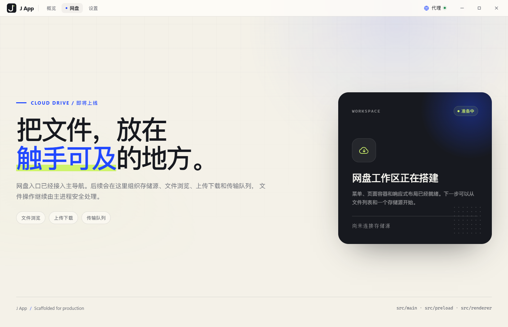

# J App

一个面向实际开发起步的 Electron 桌面应用工程：**Electron Forge + Vite + React 19 + TypeScript**。

项目已经处理好主进程、预加载脚本、渲染进程的边界，并把 IPC 契约集中到共享类型中。初始页面会通过真实的 `contextBridge` 调用读取运行时信息，可作为端到端链路是否正常的自检。


## 技术栈

- **Electron 44** — 桌面运行时
- **Electron Forge 8** — 开发、打包与安装包制作
- **Vite 8** — 主进程、预加载与渲染层构建，渲染层支持 HMR
- **React 19 + TypeScript 6** — 严格类型的界面开发
- **Vitest + Testing Library** — 渲染层单元测试
- **Zod** — 集中配置的结构校验
- **Oxlint + Oxfmt** — 静态检查与代码格式化
- **pnpm** — 依赖管理

## 快速开始

环境要求：Node.js `>= 22.12`，pnpm 11（仓库声明了 `packageManager`，Corepack 可直接识别）。

```bash
pnpm install
pnpm dev
```

`pnpm dev` 会启动 Forge 开发环境。渲染层支持 Vite HMR；主进程与预加载脚本变更后会自动重启应用。

## 常用命令

| 命令                  | 说明                                     |
| --------------------- | ---------------------------------------- |
| `pnpm dev`            | 启动开发环境（`pnpm start` 同义）        |
| `pnpm typecheck`      | 运行 TypeScript 类型检查                 |
| `pnpm lint`           | 使用 Oxlint 检查源码                     |
| `pnpm lint:fix`       | 自动修复可修复的 lint 问题               |
| `pnpm format`         | 使用 Oxfmt 格式化代码                    |
| `pnpm format:check`   | 检查格式是否符合规范                     |
| `pnpm icons:generate` | 从 `public/favicon.svg` 重新生成应用图标 |
| `pnpm test`           | 运行一次单元测试                         |
| `pnpm test:watch`     | 监听模式运行测试                         |
| `pnpm check`          | 依次执行类型检查、lint、格式检查与测试   |
| `pnpm precommit`      | 手动执行提交流程（自动修复 + 完整校验）  |
| `pnpm package`        | 打包当前平台的未压缩应用                 |
| `pnpm make`           | 生成当前平台的安装包                     |

## Git 提交钩子

项目通过 Husky 在 `git commit` 前执行 [.husky/pre-commit](.husky/pre-commit)，流程分两步：

1. `lint-staged` 只处理本次暂存的文件：`oxlint --fix` 自动修复可修复的 lint 问题，`oxfmt --write` 统一格式，并把修复结果重新加入暂存区；
2. 执行完整的 `pnpm check`，再次验证类型、lint、格式和测试。

任何一步失败都会中止提交。`pnpm install` 会通过 `prepare` 脚本自动安装钩子；也可以随时手动运行：

```bash
pnpm precommit
```

如果遇到紧急情况需要绕过检查，可以使用 `git commit --no-verify`，但不要把它当作常规流程。

## 目录结构

```text
j-app/
├─ docs/
│  ├─ preview.png               # 主界面截图
│  ├─ drive-page.png            # 网盘占位页
│  ├─ settings-page.png         # 设置占位页
│  ├─ proxy-dialog.png          # 网络代理弹窗
│  ├─ proxy-saved.png           # 开启代理后的重启提示
│  └─ proxy-saved-off.png       # 关闭代理后的重启提示
├─ public/
│  └─ favicon.svg               # 网页 favicon，也是应用图标的唯一源文件
├─ resources/
│  ├─ icon.png                  # 512px 通用图标，开发窗口与 Linux 打包使用
│  ├─ icon.ico                  # Windows 应用、任务栏与安装器图标
│  └─ icon.icns                 # macOS 应用图标
├─ scripts/
│  └─ generate-icons.mjs        # 由 favicon.svg 生成各平台图标
├─ .husky/
│  └─ pre-commit                # Git 提交前自动修复与校验
├─ .lintstagedrc.json           # 暂存文件的 Oxlint/Oxfmt 自动修复规则
├─ src/
│  ├─ main/                     # 主进程：拥有系统权限
│  │  ├─ network/
│  │  │  └─ proxy.ts            # 启动时应用代理、代理连接测试
│  │  ├─ settings/
│  │  │  ├─ defaults.ts         # 默认配置
│  │  │  ├─ schema.ts           # Zod 配置校验
│  │  │  ├─ schema.test.ts      # 配置校验测试
│  │  │  └─ store.ts            # 单文件配置仓库、原子写入与坏文件恢复
│  │  ├─ index.ts               # 应用生命周期、单实例、启动流程
│  │  ├─ ipc.ts                 # ipcMain 处理器
│  │  ├─ security.ts            # CSP 与 webview 防护
│  │  └─ window.ts              # BrowserWindow、导航与外链策略
│  ├─ preload/                  # 预加载：受控 API 边界
│  │  └─ index.ts               # contextBridge 暴露 window.desktop
│  ├─ renderer/                 # 渲染进程：只负责 UI
│  │  ├─ components/
│  │  │  ├─ AppMark.tsx          # 与桌面图标一致的内联 SVG 标志
│  │  │  ├─ GlobeIcon.tsx        # 网络代理图标
│  │  │  ├─ ProxyDialog.tsx      # 代理配置、测试与重启提示弹窗
│  │  │  └─ TitleBar.tsx         # 自定义标题栏、导航与窗口控制
│  │  ├─ hooks/
│  │  │  └─ useAppInfo.ts       # IPC 数据加载与重试
│  │  ├─ pages/
│  │  │  ├─ OverviewPage.tsx     # 概览页
│  │  │  ├─ DrivePage.tsx        # 网盘占位页
│  │  │  └─ SettingsPage.tsx     # 设置占位页
│  │  ├─ styles/
│  │  │  └─ global.css
│  │  ├─ App.test.tsx           # 渲染层测试
│  │  ├─ App.tsx                # 页面切换与全局状态
│  │  ├─ navigation.ts          # 主导航配置
│  │  └─ main.tsx               # React 入口
│  ├─ shared/                   # 三端共享的纯类型与契约
│  │  ├─ ipc.ts                 # 通道名、AppInfo、DesktopApi
│  │  ├─ settings.ts            # 应用设置与代理数据类型
│  │  └─ window.d.ts            # window.desktop 的全局类型
│  └─ types/
│     └─ electron-forge.d.ts    # Forge Vite 注入变量的类型
├─ index.html                   # 渲染层 HTML 入口
├─ forge.config.mts             # Forge、Maker 与 Fuses 配置
├─ vite.main.config.mts
├─ vite.preload.config.mts
├─ vite.renderer.config.mts
├─ vitest.config.mts
├─ tsconfig.json
├─ .oxlintrc.json
└─ .oxfmtrc.json
```

`@shared/*` 别名在 TypeScript、三个 Vite 配置和 Vitest 中保持一致，用来引用跨进程契约。进程内部代码使用相对路径，跨边界代码使用别名，避免目录移动时产生大量路径修改。

## 应用图标

`public/favicon.svg` 同时承担两个角色：

- 通过 `index.html` 的 `<link rel="icon">` 显示为页面 favicon；
- 作为应用图标源文件，由 `pnpm icons:generate` 生成 `resources/icon.png`、`icon.ico` 和 `icon.icns`。

Forge 打包时使用 `resources/icon`：Windows 自动选择 ICO、macOS 选择 ICNS、Linux 选择 PNG，并把对应图标写入应用和安装器。开发环境中的 `BrowserWindow` 直接加载 `resources/icon.png`，打包后从 `extraResource` 读取。

更换图标时，**只需替换 `public/favicon.svg` 并重新运行 `pnpm icons:generate`**，无需改动窗口或打包配置。建议保留 1:1 的 `viewBox` 和透明圆角，避免不同尺寸下的裁切差异。生成文件已提交到仓库，因此常规开发和打包不依赖图标生成步骤。

## 自定义标题栏

应用使用自定义标题栏替代系统原生标题栏：

- Windows / Linux 使用无边框窗口，由渲染层绘制最小化、最大化和关闭按钮；
- macOS 使用 `hiddenInset`，保留原生红绿灯，隐藏自定义窗口按钮；
- 标题栏整体设置为 `-webkit-app-region: drag`，导航和窗口按钮等交互元素设置为 `no-drag`。

布局和大致的扩展位置在 [`src/renderer/components/TitleBar.tsx`](src/renderer/components/TitleBar.tsx)：

- `titlebar-nav`：数据驱动的主导航，当前包含“概览 / 网盘 / 设置”；
- `titlebar-actions`：全局工具按钮区域，目前包含“网络代理”入口，也可继续添加搜索、通知等操作；
- 中间留白同时作为拖拽窗口的区域。

窗口控制通过 `window.desktop.windowControls` 暴露，渲染层拿不到原始 `ipcRenderer`。主进程根据 IPC 发送者定位窗口，并在最大化状态变化时广播事件，按钮图标会随之切换。开发模式启动时会自动在独立窗口打开 DevTools，也可以使用 `F12` 或 `Ctrl/Cmd + Shift + I` 手动切换；生产构建不会自动打开。

## 主导航与页面

主导航目前提供三个页面：

- **概览**：现有工程自检与运行环境
- **网盘**：已接入导航的占位页，用于后续文件浏览和传输功能
- **设置**：已接入导航的占位页，网络代理仍保持从标题栏独立打开

导航配置在 [`src/renderer/navigation.ts`](src/renderer/navigation.ts)。页面切换由 `App.tsx` 管理，没有引入路由依赖；切换时会回到内容顶部，并使用 `aria-current` 标记当前页面。

网盘页面：



设置页面：


页面复用当前概览的视觉 Token 与 `.content` 栅格，在窗口宽度低于 980px 时自动切换为单列。已验证在 900×620 的最小窗口尺寸下没有横向溢出。

新增页面时：

1. 在 `navigation.ts` 中加入新的导航项；
2. 在 `src/renderer/pages/` 中创建页面组件；
3. 在 `App.tsx` 中注册页面渲染分支。

当页面需要浏览器历史、深链或返回/前进能力时，再引入 React Router（Electron 下使用 `HashRouter`），当前阶段不提前增加依赖。

## 集中配置与网络代理

### 配置存储

所有运行时配置集中保存在一个文件中：

```text
app.getPath('userData')/settings.json
```

在 Windows 下即 `%APPDATA%\J App\settings.json`。当前结构：

```json
{
  "schemaVersion": 1,
  "network": {
    "proxy": {
      "enabled": true,
      "protocol": "http",
      "host": "127.0.0.1",
      "port": 7890
    }
  }
}
```

这是有意设计成“一个中心配置仓库”，而不是每个功能各自写一个文件或使用 `localStorage`：

- **只有主进程读写文件**。渲染层通过 `window.desktop.settings` 的窄接口访问，避免多处写入、路径漂移和权限问题。
- **结构集中在 `src/shared/settings.ts`**。新增设置时增加 section（如 `appearance`、`editor`），配置文件仍是同一个。
- **带 `schemaVersion` 并用 Zod 校验**。不符合当前结构的文件会被移到 `settings.invalid-<timestamp>.json` 备份，再恢复默认值，避免静默损坏。
- **原子写入**。先写同目录临时文件、同步落盘，再 rename 到目标文件，避免中途退出留下半截 JSON。
- **不用 `.env`**。`.env` 是构建时配置，不是用户运行时状态；也不应把用户代理写进仓库。
- **不把配置接口做成一个巨大的设置页**。统一存储不等于把所有 UI 堆在一起，网络代理这类全局能力可以由标题栏等上下文入口打开独立弹窗。

后续新增配置时，在 `AppSettings`、Zod schema、默认值和对应的 IPC 方法中扩展同一个结构。若修改已有字段的语义，需要提升 `schemaVersion` 并在 store 中加入迁移逻辑。当前版本不保存密码等敏感信息；如果需要代理认证，密码应使用 Electron `safeStorage` 单独加密，不能以明文写入 `settings.json`。

### 网络代理

标题栏右侧的“代理”按钮会打开独立弹窗，不进入设置页面。按钮使用状态点颜色表示当前状态：绿色为已开启，灰色为未开启。


- 支持 HTTP、HTTPS 和 SOCKS5，自定义主机与端口；
- 关闭自定义代理时使用系统代理设置；
- `localhost`、`127.0.0.1`、`::1` 等本地地址始终直连；
- 连接测试通过独立的内存 Session 访问 Google 和 GitHub，不修改当前窗口的网络状态，超时为 8 秒；
- 保存后提示配置已写入，并要求重启应用生效；保存成功页会明确区分“已开启”和“已关闭”；
- 可以选择“立即重启”（`app.relaunch()`）或稍后手动重启。


关闭自定义代理时，保存结果会明确显示为“已关闭”，并说明重启后会恢复系统代理：


应用启动时会先读取 `settings.json`，在创建窗口前通过 `session.defaultSession.setProxy()` 应用代理，并关闭旧连接池，避免复用之前的代理连接。

当前首版不支持需要账号密码的代理，也不开放自定义 bypass 列表；基础能力位于 [`src/main/network/proxy.ts`](src/main/network/proxy.ts)。

## 进程边界

### Main

`src/main` 负责窗口、生命周期、原生能力和所有 IPC 处理器。这里可以直接使用 Node.js API。业务能力按模块拆分到独立文件，再由 `index.ts` 组装；不要把所有逻辑都堆进入口文件。

### Preload

`src/preload/index.ts` 只暴露明确声明的方法，不把 `ipcRenderer` 或 Node 能力直接交给页面：

```ts
contextBridge.exposeInMainWorld('desktop', Object.freeze(desktopApi));
```

类型来自 `src/shared/ipc.ts` 中的 `DesktopApi`，渲染层通过 `window.desktop` 获得完整补全。网络代理同样通过 `window.desktop.settings` 的 `getProxy`、`saveProxy`、`testProxy` 三个窄接口访问，不暴露文件路径或任意读写能力。

### Renderer

React 代码没有 Node.js 权限，只能通过 `window.desktop` 请求主进程能力。当前示例用 `useAppInfo` 展示了加载、成功、失败和重试四种状态。

## 扩展一个 IPC 调用

1. 在 `src/shared/ipc.ts` 中增加通道名和数据类型，并把方法加入 `DesktopApi`。

```ts
export const IpcChannel = {
  GetAppInfo: 'app:get-info',
  OpenFile: 'dialog:open-file',
} as const;

export interface DesktopApi {
  getAppInfo: () => Promise<AppInfo>;
  openFile: () => Promise<string | null>;
}
```

2. 在 `src/main/ipc.ts` 中注册处理器，只返回可序列化的数据。

```ts
ipcMain.handle(IpcChannel.OpenFile, async () => {
  // 在这里校验参数并调用 Electron / Node API
});
```

3. 在 `src/preload/index.ts` 中转发调用。

```ts
const desktopApi: DesktopApi = {
  getAppInfo: () => ipcRenderer.invoke(IpcChannel.GetAppInfo),
  openFile: () => ipcRenderer.invoke(IpcChannel.OpenFile),
};
```

4. 在 React 组件或 hook 中使用 `window.desktop.openFile()`。不要在前端直接读取文件系统。

## 默认安全策略

工程在初始状态就启用了以下措施：

- `contextIsolation: true`、`nodeIntegration: false`、`sandbox: true`、`webviewTag: false`；
- 通过 `src/main/security.ts` 为页面注入按环境区分的 CSP；开发环境仅为 HMR 放开必要来源；
- 新窗口请求一律拒绝，只有 `https:` 链接会交给系统浏览器；
- 阻止跨应用导航，拒绝页面挂载 `<webview>`；
- 窗口控制走受限的 `window.desktop.windowControls` IPC，不向渲染层暴露 `ipcRenderer`；
- 用户配置由主进程校验和原子写入，损坏文件会先备份；代理测试使用隔离 Session；
- 开启 Electron Forge Fuses，包括 ASAR 完整性校验、禁用 `RunAsNode` 等；
- 打包时启用 ASAR。

上线前仍需要补充 **代码签名、自动更新策略、崩溃上报与最小化权限审计**。CSP 中的开发环境例外只应在开发服务器下生效，不要在发布版本中放宽。

## 应用标识与发布

核心信息位于 `package.json`：

```json
{
  "name": "j-app",
  "productName": "J App",
  "version": "0.1.0"
}
```

在发布前至少检查：

1. `productName`、`version`、`description`、作者信息和 `LICENSE`；
2. Windows 的 AppUserModelId（`src/main/index.ts`）和打包 Bundle ID；
3. 如果替换了图标，执行 `pnpm icons:generate` 并检查三个平台格式；
4. `forge.config.mts` 中的 Maker 与签名配置；
5. 是否需要自动更新（Squirrel / 其他更新通道）。

`pnpm make` 的产物位于 `out/`。当前 Maker 配置覆盖 Windows（Squirrel）、macOS（ZIP）、Linux（DEB / RPM）；签名与公证未配置。

## 约定

- 所有新增能力优先在 `src/shared/ipc.ts` 定义契约，再分别实现主进程和预加载层。
- TypeScript 开启 `strict`、`noUncheckedIndexedAccess`、`verbatimModuleSyntax` 等严格选项。
- 渲染层组件测试与组件放在一起，文件名使用 `*.test.tsx`。
- 使用 LF 换行和 2 个空格缩进，由 `.editorconfig`、`.gitattributes` 和 Oxfmt 统一。
- 推荐安装 `.vscode/extensions.json` 中声明的 Oxc 与 EditorConfig 插件。

## License

MIT © 2026 jia
