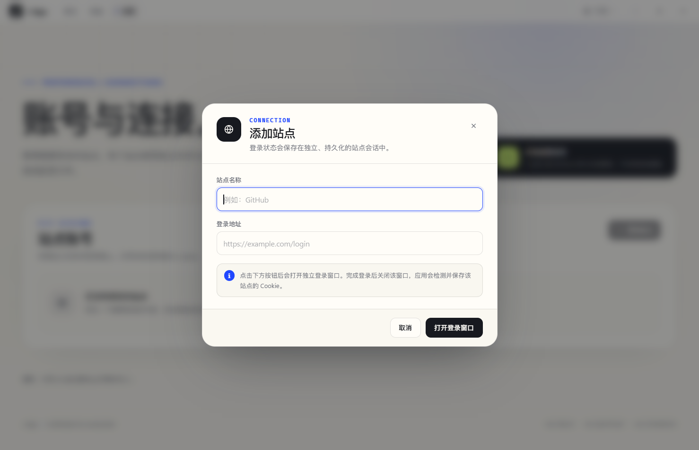

# 站点 Cookie 会话

## 1. 功能目标

应用需要访问多个需要登录的网站。该功能提供：

- 为每个站点、每个账号保存独立的持久登录态；
- 支持仅保存站点名称与地址作为预设，不打开登录窗口，之后从列表随时登录；
- 在应用内打开受控的登录窗口，由用户手动完成登录；
- Cookie 由 Electron/Chromium 的持久 Session 保存，不写入应用配置、不返回 React 渲染层；
- 支持多个站点、同一站点的多个账号；
- 登录窗口和未来抓取任务复用当前网络代理；
- 设置页提示多站点资源开销，支持固定站点、单站点移除和清理全部站点数据；
- 固定站点在执行移除或清理全部时只清除 Cookie/缓存，保留配置中的列表条目；
- 应用启动时自动删除无主站点 partition；
- 站点 Session 使用标准桌面 Chrome UA 和语言头，降低普通网站误判 Electron 客户端的情况；
- 可随时重新登录或删除会话。

当前入口位于 **设置 → 站点账号**。


## 2. 架构

```text
Renderer
  SettingsPage / AddSiteDialog / ClearAllSitesDialog
        │  仅名称、URL、状态、Cookie 数量
        ▼
Preload
  window.desktop.connections
        │  typed IPC
        ▼
Main
  connections/session-manager.ts
        ├─ BrowserWindow 登录窗口
        ├─ persist:japp-site-<uuid> Session
        ├─ site-profile.ts（Chrome UA / 语言头）
        ├─ cookies.get / cookies.flushStore
        └─ settings/store.ts（仅元数据）

  启动阶段
  connections/partition-cleanup.ts
        └─ 删除无连接元数据的 japp-site-<uuid> 目录
```

关键文件：

| 文件                                              | 职责                                     |
| ------------------------------------------------- | ---------------------------------------- |
| `src/shared/connections.ts`                       | 站点连接与摘要类型                       |
| `src/shared/ipc.ts`                               | IPC 通道与 `ConnectionsApi`              |
| `src/main/connections/session-manager.ts`         | 登录窗口、Session、Cookie 生命周期、清理 |
| `src/main/connections/site-profile.ts`            | 站点 Session 桌面 Chrome UA/语言兼容     |
| `src/main/connections/partition.ts`               | 分区命名与无主分区识别（纯函数）         |
| `src/main/connections/partition-cleanup.ts`       | 启动时删除无主分区                       |
| `src/main/settings/schema.ts`                     | 配置校验、连接元数据校验、v1 → v2 迁移   |
| `src/main/settings/store.ts`                      | 连接元数据读写                           |
| `src/renderer/pages/SettingsPage.tsx`             | 连接列表、资源提示、登录、移除、全部清理 |
| `src/renderer/components/AddSiteDialog.tsx`       | 添加站点或仅保存预设                     |
| `src/renderer/components/ClearAllSitesDialog.tsx` | 清理全部站点确认弹窗                     |
| `src/preload/index.ts`                            | 只暴露状态与操作，不暴露 Cookie          |

渲染层永远不会收到 Cookie 值，只收到 `cookieCount` 和 `connected / empty` 状态。

## 3. 存储模型

### 3.1 配置中的元数据

`settings.json` 只保存非敏感的连接信息：

```json
{
  "schemaVersion": 3,
  "network": {
    "proxy": {
      "enabled": false,
      "protocol": "http",
      "host": "",
      "port": 0
    }
  },
  "connections": {
    "sites": [
      {
        "id": "0f2a63a7-0a9f-4b0a-9d0b-6b8e1c1a2f5d",
        "name": "GitHub",
        "loginUrl": "https://github.com/login",
        "createdAt": "2026-10-21T02:00:00.000Z",
        "lastLoginAt": "2026-10-21T02:10:00.000Z",
        "pinned": true
      }
    ]
  },
  "appearance": {
    "theme": "system"
  }
}
```

没有 Cookie 字段、密码字段或 Token 字段。

### 3.2 Cookie 实际存储位置

每个连接使用独立持久分区：

```text
persist:japp-site-<connection-id>
```

实际数据位于 Electron `userData` 下的 Partition 目录，例如 Windows：

```text
%APPDATA%\J App\Partitions\japp-site-<id>\Network\Cookies
```

Cookie 由 Chromium 管理，项目已启用 Electron Forge 的 `EnableCookieEncryption` Fuse。加密密钥由操作系统密钥存储/DPAPI 等机制管理，不使用 `settings.json` 或 `safeStorage` 手工保存 Cookie。

禁止直接读取、修改或迁移 Chromium 的 Cookies SQLite 文件。

### 3.3 为什么 Cookie 不放进中心配置

“配置集中化”适用于非敏感运行状态，不适用于凭据。Cookie 需要：

- 由浏览器处理 HttpOnly、SameSite、Domain、Path、过期时间；
- 支持登录页面自动写入和更新；
- 避免在日志、崩溃报告和 IPC 中出现 Cookie 值；
- 使用操作系统加密存储，而不是明文 JSON。

因此本项目采用：

```text
settings.json       → 站点元数据
Chromium Partition  → Cookie 本体
```

这是中心配置原则的明确例外，功能文档和代码中都保持这一边界。

## 4. 添加与登录流程

添加站点有两个入口：

- **仅保存站点**：调用 `createPreset`，只写入名称、URL 等元数据，不打开登录窗口；
- **保存并登录**：打开受控登录窗口，登录成功后写入元数据并保存 Cookie。

预设站点在列表中显示为“待登录”，操作按钮为“登录”；点击后复用同一套登录窗口和分区流程。

1. 用户在设置页填写站点名称与登录地址；
2. 主进程校验名称和 URL，生成 UUID；
3. 登录地址只允许 `https:`；本地开发额外允许 `http://localhost` / `127.0.0.1` / `::1`；
4. 为站点 Session 设置标准桌面 Chrome UA 与 `zh-CN,zh,en` 语言头；
5. 主进程创建 `BrowserWindow`：
   - 使用对应的 `persist:` 分区；
   - `contextIsolation: true`；
   - `nodeIntegration: false`；
   - `sandbox: true`；
   - `webviewTag: false`；
   - 不加载应用 preload；
   - 打开前应用当前代理。

6. 用户在弹出的独立登录窗口中完成登录；
7. 用户关闭登录窗口，表示“登录流程结束”；
8. 主进程读取与登录地址匹配的 Cookie：

   ```ts
   const cookies = await siteSession.cookies.get({ url: loginUrl });
   ```

9. 数量为 0：不保存站点；新建流程会清理临时分区；
10. 115 站点会额外调用 `https://webapi.115.com/offine/downpath` 验证真实登录态；只有游客/风控 Cookie 时保存失败，并提示完成登录；
11. 登录校验通过后，115 的会话型账号 Cookie 会被提升为 30 天持久 Cookie，再由 Chromium 加密持久化；
12. 数量大于 0 且登录校验通过：调用 `session.cookies.flushStore()`，确保立即退出/重启也不会丢失 Cookie，然后写入连接元数据；
13. 渲染层刷新状态，只显示数量。



### 为什么由用户关闭窗口

应用不知道任意网站何时算“登录完成”。如果看到第一个 Cookie 就自动关闭窗口，很可能在用户输入账号前就保存了匿名或分析 Cookie。因此采用明确的人工完成信号：**完成登录后关闭窗口**。

登录窗口标题会固定提示这一操作，不允许网站修改窗口标题。

### 登录窗口安全边界

- 仅允许 `https:` 导航；本地回环地址允许 HTTP；
- 拒绝 `<webview>`；
- 新窗口（例如 OAuth 弹窗）只允许 HTTPS 或本地回环 HTTP，并继承同一个分区和安全 webPreferences；
- 登录窗口不使用应用 preload，第三方页面无法访问 `window.desktop`；
- 不使用 iframe 或 `<webview>` 嵌入登录页。

## 5. 多站点与多账号

- 每个连接有独立 UUID 和独立 partition，因此同一站点可以添加多个账号；
- Cookie 不会在连接之间共享；
- 连接名称可重复，但 ID 唯一；
- 同一时间只允许一个登录窗口，避免并发登录写入混乱；
- 站点可以固定；固定状态保存在 `settings.json` 的 `connections.sites[].pinned`；
- 未固定站点移除时清除对应 partition 的 Cookie、localStorage、IndexedDB、CacheStorage、Service Worker 和缓存，然后删除元数据；
- 固定站点移除时执行相同的存储清理，但保留元数据和列表条目，状态变为“待登录”；
- 取消固定后按普通站点处理。

### 5.1 资源占用提示

设置页始终显示资源提示：

- 每个站点都有独立的持久 Session、Cookie 存储和缓存；
- Electron 主进程、渲染进程、GPU 和网络服务本身已有固定内存开销；
- 连接越多，磁盘缓存、登录窗口和目标站点加载产生的内存峰值越高；
- 建议只添加确实需要长期保留的站点，不用的连接及时删除。

界面不会用这个提示阻止添加站点，但“清理全部站点数据”会作为高风险操作放在卡片底部的危险区域。

### 5.2 清理全部站点数据

入口位于站点卡片底部：

1. 点击“清理全部”；
2. 二次确认弹窗显示站点数量、固定站点数量、Cookie/缓存影响范围；
3. 确认后主进程逐个清空所有连接存储；
4. 只有全部存储操作成功后，才删除未固定站点元数据；
5. 固定站点保留元数据和列表条目，状态变为“待登录”；
6. 任意一个清理失败都会保留元数据，方便用户重试，避免出现无法在 UI 中管理的数据；
7. 渲染层更新剩余固定站点列表；如果没有固定站点则显示空状态。

“清理全部”只删除站点连接数据，不影响代理、界面和其他应用设置。

### 5.3 启动时清理无主 partition

应用启动时，在创建窗口和任何站点 Session 之前：

1. 读取 `settings.json` 中的连接 ID；
2. 扫描 `userData/Partitions`；
3. 只识别符合 `japp-site-<uuid>` 命名的目录；
4. 删除没有对应连接元数据的目录；
5. 保留仍被配置引用的 partition，以及所有不符合该命名规则的目录；
6. 删除失败只记录日志，不阻塞启动，下一次启动会继续尝试。

这解决了以下情况留下的孤儿 Cookie 数据：

- 站点连接已被移除，但 partition 目录还在；
- 添加站点失败后留下的空 partition；
- `settings.json` 损坏并被重置后，旧连接元数据消失；
- 清理全部后留下的空目录。

注意：清理全部站点数据后，未固定站点的 partition 目录可能立即保留为空目录，应用重启时才会被一并删除；固定站点的 partition 因元数据仍保留而不会被回收。

### 5.4 站点访问兼容性

部分网站会根据 User-Agent 拒绝 Electron 默认 UA，即使登录窗口使用真实的 Chromium。站点 Session 因此采用：

- 标准桌面 Chrome UA，例如：
  `Mozilla/5.0 (Windows NT 10.0; Win64; x64) AppleWebKit/537.36 (KHTML, like Gecko) Chrome/... Safari/537.36`
- `zh-CN,zh,en` 语言偏好；
- 每个站点 Session 独立设置，不影响应用主窗口。

使用 Chrome UA 后，登录窗口和 `siteSession.fetch()` 的常规网页请求会使用相同身份。**这不是 Cloudflare、CAPTCHA 或地区限制的绕过机制。** 如果普通浏览器在同一网络正常而应用仍被拦截，应停止尝试规避，改用官方 API、联系站点，或确认站点是否允许自动化访问。

对于已经保存的 `cf_clearance` 等绑定 UA/IP 的 Cookie，切换 UA 后可能失效；更新后可移除该站点并重新登录一次。

## 6. 在业务中读取登录态

业务代码应通过主进程使用 Session，而不是让渲染层请求 Cookie 字符串。

```ts
import { getSiteSession } from '../connections/session-manager';

const siteSession = await getSiteSession(connectionId);

if (!siteSession) {
  throw new Error('站点连接不存在');
}

const response = await siteSession.fetch('https://example.com/api/files');
```

`getSiteSession` 会：

- 校验连接存在；
- 获取对应持久分区；
- 应用当前代理配置；
- 返回 Electron `Session` 给主进程内部使用。

推荐继续使用 `siteSession.fetch()`，这样 Cookie、代理和跳转都由 Electron 网络栈处理，业务代码不需要读取 Cookie。

如果必须使用只接受 Cookie Header 的 HTTP 客户端，只能在主进程中临时读取：

```ts
const cookies = await siteSession.cookies.get({ url });
const cookieHeader = cookies
  .map((cookie) => `${cookie.name}=${cookie.value}`)
  .join('; ');
```

约束：

- Cookie 只存在于主进程内存；
- 不写日志、不写入配置文件、不通过 IPC 返回；
- 请求结束立即释放引用；
- 优先使用 `session.fetch`，避免手工处理 Cookie。

未来抓取任务应把 `connectionId` 作为参数，由主进程解析 Session；不要把 Cookie 作为任务参数从渲染层传入。

## 7. 与网络代理的配合

站点登录 Session 和普通请求使用同一份代理配置。

- 每次创建/使用站点 Session 前调用 `applyProxyToSession()`；
- 登录窗口在加载远程页面之前应用代理；
- `getSiteSession()` 在返回 Session 前应用代理；
- 代理配置仍按现有规则需要重启应用后生效；
- 代理测试使用隔离的测试 Session，不影响站点连接。

这样可以避免出现“主窗口走代理，但抓取 Session 直连”的不一致。

## 8. IPC 与类型

新增通道：

```ts
ListSiteConnections: 'connections:list',
CreateSiteConnection: 'connections:create',
CreateSitePreset: 'connections:create-preset',
LoginSiteConnection: 'connections:login',
SetSiteConnectionPinned: 'connections:set-pinned',
RemoveSiteConnection: 'connections:remove',
ClearSiteConnections: 'connections:clear-all',
```

渲染层 API：

```ts
interface ConnectionsApi {
  list(): Promise<readonly SiteConnectionSummary[]>;
  create(input: CreateSiteConnectionInput): Promise<SiteConnectionSummary>;
  createPreset(
    input: CreateSiteConnectionInput,
  ): Promise<SiteConnectionSummary>;
  login(connectionId: string): Promise<SiteConnectionSummary>;
  setPinned(input: {
    connectionId: string;
    pinned: boolean;
  }): Promise<SiteConnectionSummary>;
  remove(connectionId: string): Promise<{
    removed: boolean;
    connection: SiteConnectionSummary | null;
  }>;
  clearAll(): Promise<{
    clearedCount: number;
    remaining: readonly SiteConnectionSummary[];
  }>;
}
```

`remove()` 对固定站点返回 `{ removed: false, connection: 清理后的摘要 }`，对普通站点返回 `{ removed: true, connection: null }`。

摘要类型：

```ts
interface SiteConnectionSummary {
  id: string;
  name: string;
  loginUrl: string;
  createdAt: string;
  lastLoginAt: string | null;
  pinned: boolean;
  cookieCount: number;
  status: 'connected' | 'empty';
}
```

## 9. 配置版本迁移

配置从 `schemaVersion: 1 / 2` 升级到 `3`：

- v1 中的 `network.proxy` 保留；
- 自动增加 `connections.sites = []`；
- v2 中已有的站点连接保留；
- 所有旧版本自动补充 `pinned = false`；
- 所有旧版本自动补充 `appearance.theme = "system"`；
- 启动时完成校验并写回 v3；
- 无效配置仍按既有策略备份为 `settings.invalid-<timestamp>.json`。

迁移集中在 `src/main/settings/schema.ts`，存储写入逻辑在 `src/main/settings/store.ts`。

## 10. 状态、失败与清理

| 场景                  | 行为                                                                     |
| --------------------- | ------------------------------------------------------------------------ |
| 仅保存站点            | 只写元数据，不创建登录窗口；列表显示“待登录”                             |
| 登录窗口内没有 Cookie | 新建不保存，旧连接保留并提示失败                                         |
| 用户提前关闭登录窗口  | 与“没有 Cookie”相同                                                      |
| 添加站点失败          | 清理新建的临时 partition                                                 |
| 重新登录失败          | 不删除原连接和已有 Cookie                                                |
| 登录窗口已存在        | 拒绝第二个登录窗口                                                       |
| 删除站点              | 清空 partition 数据后删除元数据；固定站点保留元数据并显示待登录          |
| 固定/取消固定         | 只更新 `pinned`，不清理 Cookie 或会话数据                                |
| 清理全部站点数据      | 清空所有 partition；删除未固定元数据，保留固定元数据；空目录下次启动回收 |
| 清理中途失败          | 保留元数据，用户可重试；已清空的连接会显示待登录状态                     |
| 启动时无主分区        | 删除没有连接元数据的 `japp-site-<uuid>` 分区                             |
| Cookie 过期           | 状态仍可能显示“已保存”，以 Cookie 数量为准；需要重新登录或后续验证策略   |

当前只以 Cookie 数量判断 `connected`，**不代表登录态一定仍有效**。后续接入具体站点时，可以增加 provider adapter 做轻量鉴权请求验证。

## 11. 安全与隐私

- Cookie 值不进入 React state、DOM、URL、日志或 `settings.json`；
- 登录窗口与主应用隔离，无 preload/Node；
- 每个站点、每个账号使用独立分区，减少跨站点泄露；
- 登录窗口只允许 HTTPS，本地 HTTP 仅限回环地址；
- 删除连接和清理全部都会主动清空站点存储；固定站点保留元数据但清除登录态；
- 启动时自动删除无连接元数据的站点分区，避免配置损坏后留下无法管理的 Cookie；
- 不保存账号密码；用户直接在被托管的登录窗口中输入凭据；
- 站点 Session 使用标准 Chrome UA 仅解决兼容性问题，不用于绕过访问控制；
- Cookie 加密能力依赖操作系统密钥存储；在 Linux 等平台，Electron 的加密后端可能因系统钥匙串环境不同而不同；
- 登录态抓取需要遵守目标站点条款和适用法律。

## 12. 已知限制

- 不做自动登录完成检测，必须关闭登录窗口作为完成信号；
- 不提供 Cookie 编辑、导入或导出；
- 不支持把登录态迁移到另一台设备，换设备需要重新登录；
- 当前状态只检查 Cookie 是否存在，不验证其服务端有效性；
- Cookie 检测以登录地址为作用域；如果认证完全发生在另一个域名，或 Cookie 只作用于其他路径，可能检测不到，需要调整登录地址或增加 provider 验证适配；
- 若站点只写入非持久 Session Cookie，应用无法安全地强制其永久化，重启后可能失效；
- “清理全部站点数据”完成后，partition 空目录要到下一次启动才会被无主分区清理删除；
- 启动清理只处理规范的 `japp-site-<uuid>` 目录，不符合命名规则的内容会保留，避免误删其他数据；
- 标准 Chrome UA 只能改善 UA 兼容性，不能保证通过 Cloudflare 挑战、CAPTCHA、地区限制或服务端风控；
- 切换 UA 后，旧 UA 绑定的 `cf_clearance` 等 Cookie 可能失效，需要重新登录；
- 同一时间只支持一个登录窗口；
- 不支持任意协议登录，只允许 HTTPS 和本地 HTTP；
- 站点若使用特殊客户端证书、Passkey 或非标准认证流程，需要单独适配；
- 暂未注册 provider-specific adapter；当前实现面向任意 HTTPS 登录站点。

## 13. 验证记录

已通过本地测试站点完成端到端验证：

- 连续添加两个登录会话，两个独立 partition 均成功保存 Cookie；
- 仅保存站点不会打开登录窗口，页面目标数量保持为 1；
- 仅保存的元数据写入 `settings.json`，重启后仍显示“待登录”；点击“登录”会重新打开登录窗口；
- 每个连接检测到 2 个 Cookie，`settings.json` 仅包含连接元数据，不包含 Cookie 值；
- 每个 partition 生成独立的 Cookies SQLite 文件，Cookie 以大整数过期时间和非空加密值存储；
- 强制结束应用并重启后，连接仍显示 `2 个 Cookie / 已保存`；
- 重新登录会打开相同 partition，更新 `lastLoginAt`，Cookie 数量保持正确；
- 移除连接后元数据被删除，对应 partition 的 Cookies 表清空，另一连接不受影响；
- 设置页显示资源占用警告，清理全部入口只在有站点时出现；
- 固定站点显示“已固定”，固定状态写入 `settings.json`；
- 固定站点点击“清除 Cookie”后保留列表并显示“待登录”，未固定站点移除后从列表消失；
- 清理全部后未固定连接元数据删除，固定连接保留且只清空 Cookie；
- Vitest 覆盖添加、仅保存站点、列表、重新登录、固定/取消固定、固定站点清理、移除、清理全部和渲染层资源提示；
- 当前总测试数 135；
- 启动时保留有元数据的 partition、删除伪造的无主 partition，并保留不符合命名规则的目录；
- 登录窗口 User-Agent 为标准桌面 Chrome UA，不包含 `Electron`；请求语言头为中文优先；
- 在 900×620 视口下设置页无横向溢出；
- 打包运行期间无渲染层异常或控制台错误。

本地开发验证可以使用回环 HTTP 服务返回：

```http
Set-Cookie: session=local-test-token; Path=/; Max-Age=86400; HttpOnly; SameSite=Lax
Set-Cookie: theme=cream; Path=/; Max-Age=86400; SameSite=Lax
```

完成登录后关闭登录窗口，再重启应用确认状态仍在。

## 14. 后续扩展建议

- 为具体站点增加 `SiteProvider`，提供登录 URL、允许域名和鉴权验证；
- 为列表增加“验证登录态”操作；
- 让后台抓取任务使用 `connectionId` 获取 Session，不传递 Cookie；
- 在连接数量增多后按域分组、搜索和批量清理；
- 如果需要长期在后台更新 Cookie，增加 `before-quit` 的 Session 刷新策略；
- 如果加入 Cookie 导入/导出，必须先设计显式用户确认和 `safeStorage` 加密的独立 secrets 存储，不能写入 `settings.json`。
