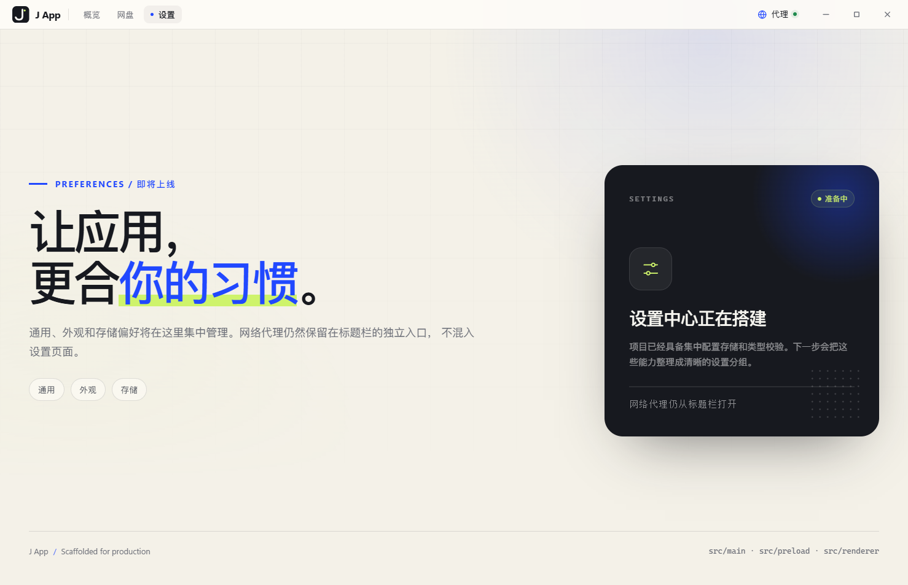
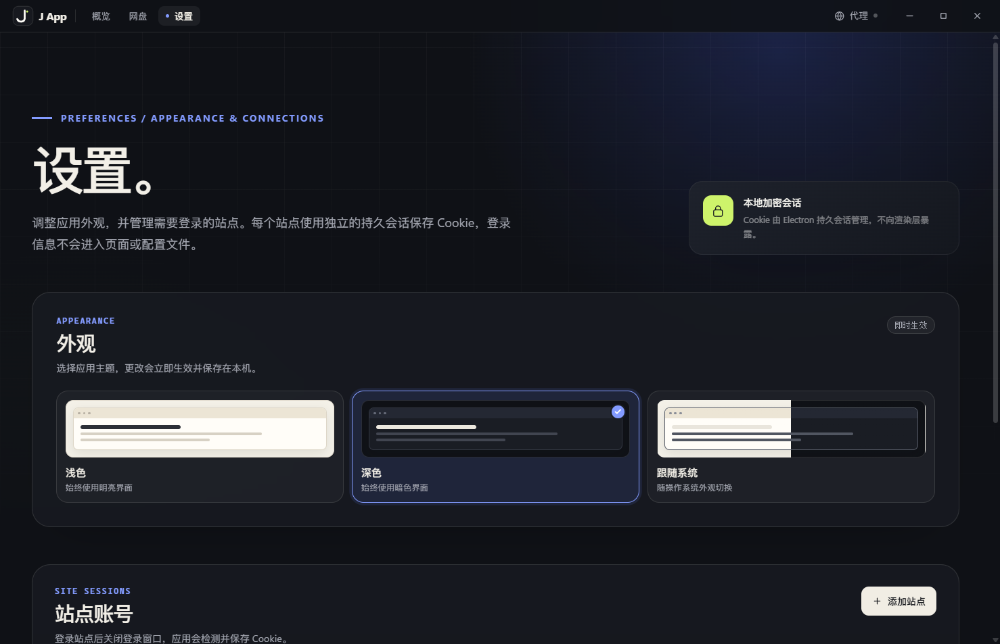
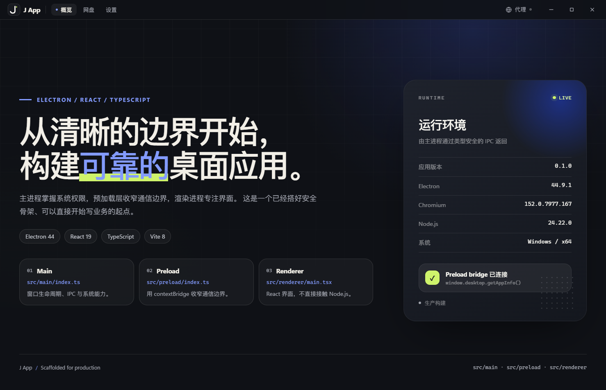

# 主题与外观

## 1. 功能目标

应用支持三种主题偏好：

- **浅色**：默认值，固定使用明亮界面；
- **深色**：固定使用暗色界面；
- **跟随系统**：随操作系统外观自动切换。

主题保存在中心配置中，启动时在创建窗口之前应用，避免先渲染浅色再切换造成的闪烁。







## 2. 架构

```text
Renderer
  ThemeSettings
        │ appearance.get / setTheme
        ▼
Preload
  window.desktop.appearance
        │ typed IPC
        ▼
Main
  appearance/theme.ts
        ├─ nativeTheme.themeSource
        ├─ 启动前应用已保存主题
        └─ 根据 resolved theme 设置窗口背景色

Renderer CSS
  @media (prefers-color-scheme: dark)
        └─ Chromium 根据 nativeTheme 选择主题 Token
```

关键文件：

| 文件                                               | 职责                               |
| -------------------------------------------------- | ---------------------------------- |
| `src/shared/appearance.ts`                         | 主题偏好、解析结果与状态类型       |
| `src/main/appearance/theme.ts`                     | 启动应用主题、切换主题、窗口背景色 |
| `src/main/settings/schema.ts`                      | v1/v2 → v3 迁移与主题校验          |
| `src/main/settings/store.ts`                       | 持久化 `appearance.theme`          |
| `src/renderer/components/ThemeSettings.tsx`        | 三档主题选择和预览                 |
| `src/renderer/components/ThemeSettings.module.css` | 主题选择器、暗色与响应式样式       |
| `src/renderer/components/TitleBar.module.css`      | 标题栏暗色与响应式样式             |
| `src/renderer/pages/SettingsPage.module.css`       | 设置页、站点卡片与暗色状态         |
| `src/renderer/styles/global.css`                   | 全局样式入口                       |
| `src/renderer/styles/tokens.css`                   | 亮/暗设计 Token                    |
| `src/renderer/styles/base.css`                     | 应用外壳与全局暗色背景             |
| `src/main/window.ts`                               | 启动窗口背景色                     |
| `src/main/connections/session-manager.ts`          | 登录窗口背景色                     |

## 3. 配置与迁移

配置升级到 `schemaVersion: 3`：

```json
{
  "schemaVersion": 3,
  "network": {
    "proxy": {
      "enabled": false,
      "protocol": "http",
      "host": "",
      "port": 0
    }
  },
  "connections": {
    "sites": []
  },
  "appearance": {
    "theme": "dark"
  }
}
```

- 新安装默认 `theme: "light"`；
- v1 配置迁移时补充空连接列表，并写入 `theme: "system"`；
- v2 配置迁移时保留已有站点连接，并写入 `theme: "system"`；
- 非法主题值会被 Zod 拒绝；
- 迁移完成后由 store 写回 v3。

## 4. 为什么没有主题闪烁

主进程启动顺序：

```text
读取 settings.json
  → applyThemePreference(settings.appearance.theme)
  → 设置 nativeTheme.themeSource
  → 计算窗口背景色
  → 创建 BrowserWindow
  → 加载 renderer
```

Electron 的 `nativeTheme.themeSource` 会同步影响渲染进程的 `prefers-color-scheme`。窗口创建前已设置主题，因此首屏 CSS 已经是正确模式。

- `system`：使用操作系统当前外观；
- `light`：强制浅色；
- `dark`：强制深色；
- `BrowserWindow.backgroundColor` 根据 `nativeTheme.shouldUseDarkColors` 设置，避免窗口首帧白闪；
- 站点登录窗口也使用对应背景色。

没有使用 `localStorage`，也没有在 React 首次渲染后异步切换主题。

## 5. CSS 实现

基础颜色由 `tokens.css` 中的亮色 `:root` 与暗色 `@media` 变量控制。应用外壳、页面背景和全局元素的暗色规则在 `base.css`；标题栏、主题选择器、页面、弹窗和共享控件的暗色规则各自随 CSS Module 加载，不再维护集中式 `theme-dark.css`。

```css
@media (prefers-color-scheme: dark) {
  :root {
    color-scheme: dark;
    --ink: #f2efe7;
    --muted: #a5a8b2;
    --paper: #0f1116;
    --surface: #1a1d24;
    --line: rgb(242 239 231 / 12%);
    --blue: #839bff;
    --success: #6fd395;
    --danger: #ff7d82;
  }
}
```

暗色设计没有简单反转颜色，而是单独调整了：

- 页面背景、网格和蓝/绿光晕；
- 标题栏、导航、窗口控制；
- 卡片、会话面板、表单、弹窗和底部操作区；
- 深色面板（运行环境、站点安全提示）使用更深的分层背景和边框；
- 警告、错误、危险操作使用暗色语义背景；
- 主按钮改为浅色底 + 深色字，保留原有黑色/米白对比关系；
- `color-scheme: dark` 同步原生滚动条、输入控件和下拉菜单；
- 所有焦点环、悬停态、禁用态在暗色下重新检查。

主题预览本身始终展示对应的浅色/深色缩略图，不跟随当前主题，以免用户无法比较三种模式。

## 6. 交互与状态

设置页“外观”卡片提供三张带缩略预览的单选卡：

- 使用原生 `radio` 保持键盘和辅助技术语义；
- 选中项显示蓝色边框、勾选标记和淡蓝背景；
- 切换即时生效，不需要重启；
- 主题写入成功后更新选择状态；写入失败时保留旧状态并显示错误；
- 系统模式切换时，页面通过 CSS media query 自动响应，不依赖 React 监听。

## 7. 验证记录

- 浅色、深色、跟随系统三种选择均能即时生效；
- 系统模式在当前系统为深色时返回 `resolved: "dark"`；
- 深色主题下 `color-scheme`、标题栏、卡片、弹窗、输入框和危险操作均使用暗色样式；
- 暗色页面视觉审计只发现主题预览和主按钮的预期浅色背景；
- 切换主题后重启应用，仍以深色启动，设置页选中“深色”；
- 900×620 视口下主题选项仍为三列且无横向溢出（窗口最小尺寸为 900×620；更窄的 Web 预览会变成单列）；
- Vitest 覆盖主题选择交互、配置迁移和主题值校验；
- 打包应用无渲染层异常或控制台错误。

当前测试总数为 48 个，`pnpm check` 全部通过。

## 8. 已知限制

- 站点登录窗口中的第三方网页由站点自身控制颜色，不保证跟随应用主题；应用的窗口背景和原生控件会使用对应系统模式。
- 仅在客户端切换主题，不提供按页面或按站点单独设主题。
- 系统模式的实际外观由操作系统决定，应用不提供额外的自动切换时间表。
- 主题依赖 Electron `nativeTheme`；在非 Electron 浏览器预览时只能依赖浏览器自身的 `prefers-color-scheme`。

## 9. 后续扩展

- 增加高对比度/减少透明度选项；
- 将主题偏好同步到未来新增的窗口和托盘菜单；
- 如果增加自定义强调色，扩展 `appearance` schema，而不是继续添加分散的 CSS 覆盖；
- 为暗色模式补充自动化截图回归测试。
